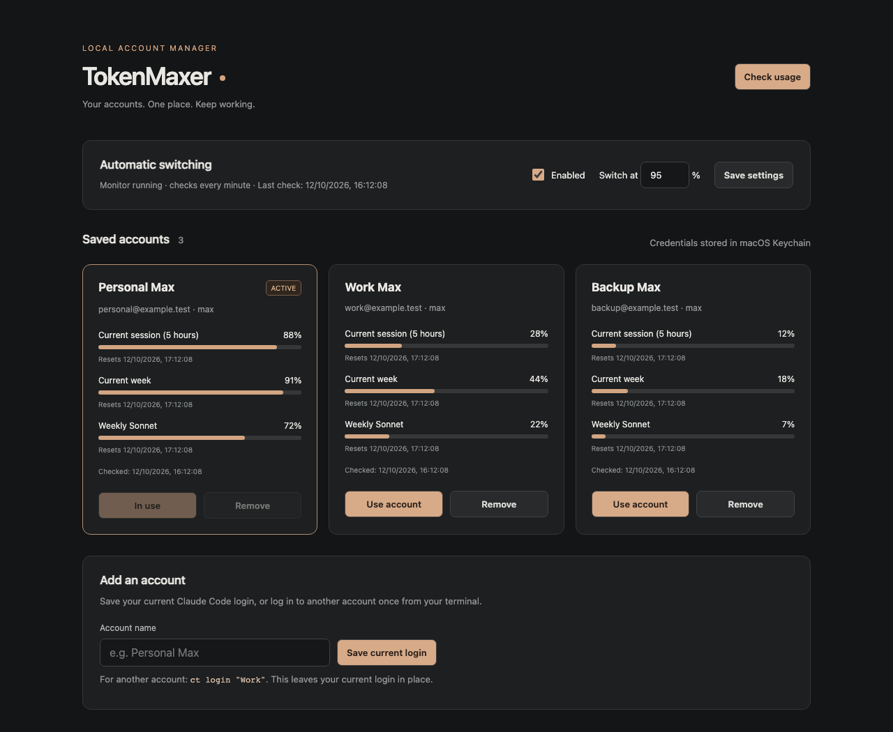
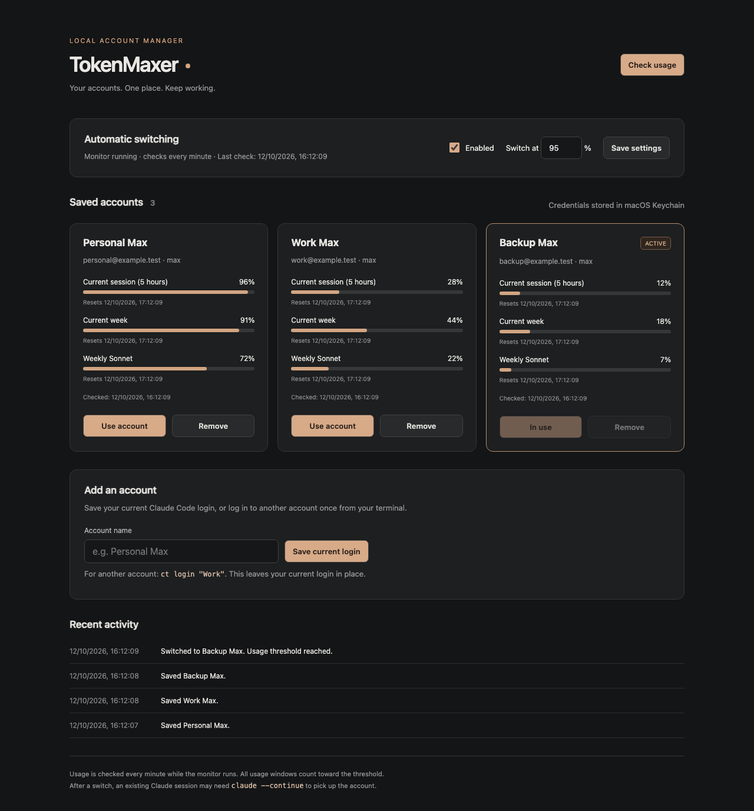

# TokenMaxer

Manage multiple Claude Code accounts from a local dashboard. Save each login once, switch accounts without repeating browser login, and switch automatically when usage gets high.

Requires **macOS**, **Node.js 20+**, and **Claude Code**.



*Screenshots use demo accounts.*

## Installation

```sh
git clone https://github.com/fspah/tokenmaxer.git
cd tokenmaxer
npm ci
npm link
npm start
```

Open [localhost:4317](http://127.0.0.1:4317). `npm link` installs the `ct` command.

## Usage

### Add accounts

Save your current Claude login, then log in to another account:

```sh
ct capture "Personal"
ct login "Work"
```

Adding an account leaves your current login in place. Credentials stay in macOS Keychain.

### Switch accounts

```sh
ct switch "Work"
ct status
```

Or click **Use account** in the dashboard.

### Automatic switching

While the dashboard runs, TokenMaxer checks usage every minute. At **95% usage**, it switches to the saved account with the most available capacity. Change the threshold or turn switching off in the dashboard.

<details>
<summary>See automatic switching in action</summary>



</details>

To start the monitor automatically at login:

```sh
ct install-daemon
```

Stop it with `ct uninstall-daemon`.

### Other commands

```sh
ct poll                 # Check usage now
ct run -- --continue    # Check usage, then launch Claude
ct remove "Work"        # Remove an inactive saved account
ct help                 # Show all commands
```

## Notes

- An open Claude session may need `claude --continue` after switching.
- If every account is exhausted, TokenMaxer waits for capacity to return.
- Expired or revoked logins can be renewed with `ct login "Work"`.
- Uses Claude Code's internal usage API, which may change with updates.

## Tests

```sh
npx playwright install chromium
npm test
```

22 Playwright tests cover switching, usage, token refresh, and failure recovery.
